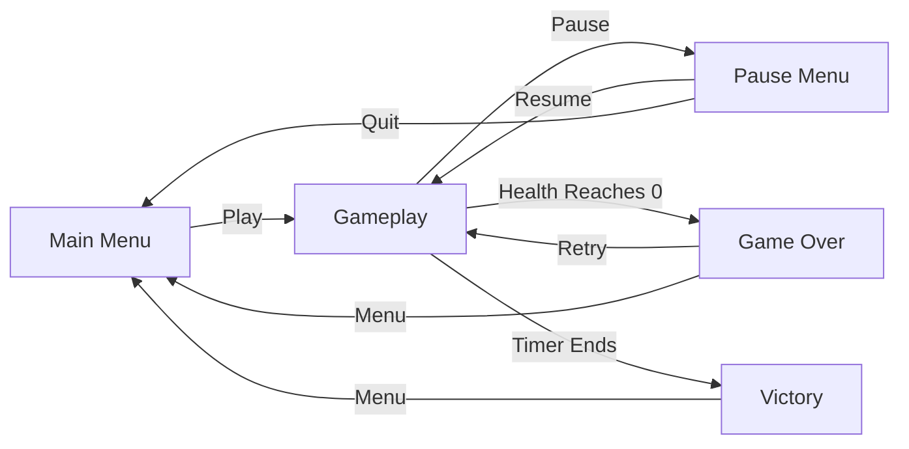
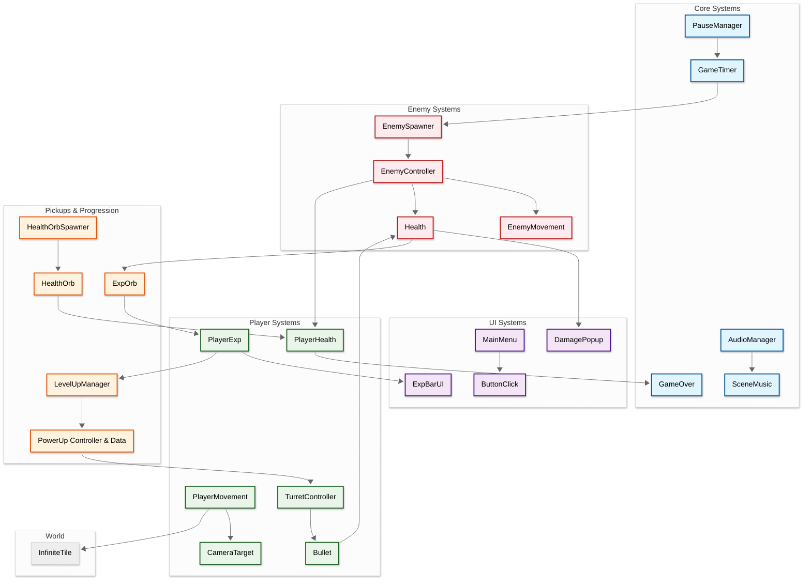
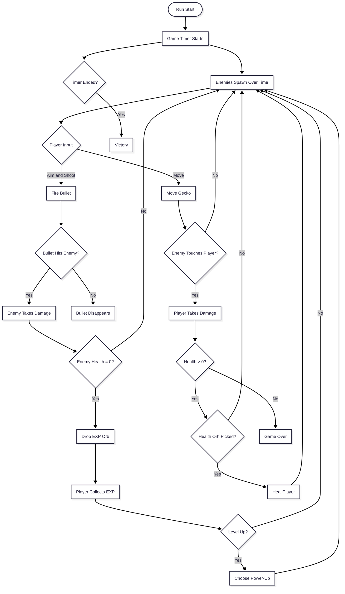

## Developer & Contributions
**Dicco** (Game Artist & Programmer)  
**Jevon** (Programmer)  
**Angel** (Programmer)

## About
Gecko Of All Time is a 2D roguelike bullet-heaven in the style of Vampire Survivors. Play as a gecko in an endless arena, aim your shots at swarming enemies, collect EXP orbs to level up, and pick power-ups to build a stronger run. Stay alive until the timer runs out to win.

 

## Key Features

**Aimed Shooting**: Aim with the mouse or touch to fire bullets at the waves of enemies closing in from all sides.

**Level Up & Power-Ups**: Defeated enemies drop EXP orbs. Fill the EXP bar to level up and choose a power-up, including turrets that add extra firepower.

**Survive the Clock**: A run lasts until the game timer ends. Enemy spawns ramp up as time passes, so keep moving and keep shooting.

**Health Orbs**: Health orbs spawn during the run to heal you, so a risky pickup can keep you alive a little longer.

**Endless Arena**: An infinitely tiling map follows the player, so the arena never runs out.

<table>
<tr>
<td align="center" width="50%">
<strong>Bullet-Heaven Combat</strong> 
Aim and shoot as enemies swarm the gecko

</td>
<td align="center" width="50%">
<strong>Level-Up Power-Ups</strong> 
Collect EXP and pick a power-up on each level

</td>
</tr>
</table>

## Scene Flow

## Layer / Module Design

## Modules and Features

The bullet-heaven gameplay, enemy waves, EXP progression and power-up system is powered by a Unity C# scripting system.

| 📂 Name | 🎬 Scene | 📋 Responsibility |
|---------|----------|-------------------|
| **PlayerMovement** | **Gameplay** | - Move the gecko around the arena |
| **PlayerHealth** | **Gameplay** | - Track player health - Take damage from enemies and heal from health orbs - Trigger game over on death |
| **PlayerExp** | **Gameplay** | - Collect EXP and track the current level - Update the EXP bar - Trigger the level-up screen |
| **CameraTarget** | **Gameplay** | - Make the camera follow the player |
| **TurretController** | **Gameplay** | - Control turrets that shoot at enemies |
| **Bullet** | **Gameplay** | - Move projectiles and apply damage on hit |
| **EnemySpawner** | **Gameplay** | - Spawn enemies around the player over time |
| **EnemyController** | **Gameplay** | - Handle enemy behavior, contact damage and death - Drop EXP orbs |
| **EnemyMovement** | **Gameplay** | - Move enemies toward the player |
| **Health** | **Gameplay** | - Shared health component for damageable objects |
| **DamagePopup** | **Gameplay** | - Show floating damage numbers |
| **ExpOrb** | **Gameplay** | - Dropped by enemies, collected by the player for EXP |
| **HealthOrb / HealthOrbSpawner** | **Gameplay** | - Spawn healing pickups during the run - Heal the player on pickup |
| **LevelUpManager** | **Gameplay** | - Pause the game on level up - Offer power-up choices |
| **PowerUp Controller & Data** | **Gameplay** | - Define power-up data - Apply the chosen power-up effects |
| **InfiniteTile** | **Gameplay** | - Tile the background endlessly around the player |
| **GameTimer** | **Gameplay** | - Count the run time and end the run when the timer finishes |
| **PauseManager** | **Gameplay** | - Pause and resume the game |
| **GameOver** | **Gameplay** | - Show the game over screen and retry options |
| **ExpBarUI** | **Gameplay** | - Display EXP progress and level |
| **MainMenu** | **Main Menu** | - Play and Quit buttons |
| **ButtonClick** | **All Scenes** | - Play click sound effects on buttons |
| **AudioManager / SceneMusic** | **All Scenes** | - Manage music and sound effects per scene |

 

## Game Flow Chart

 

## Play The Game
<a href="https://YOUR-ITCH-LINK-HERE">Play Now on itch.io</a>

 

## Installation & Setup
1. Clone this repository
2. Open the project in Unity
3. Open the main menu scene
4. Press Play to start testing

## Controls
- **Mouse / Touch** - Aim and shoot
- **WASD / Virtual Joystick** - Move *(update to match your bindings)*
- **Escape** - Pause Menu

## Credits
Game developed as a team project for the Game Development Capstone.

- Engine: Unity
- Pixel art: Aseprite
